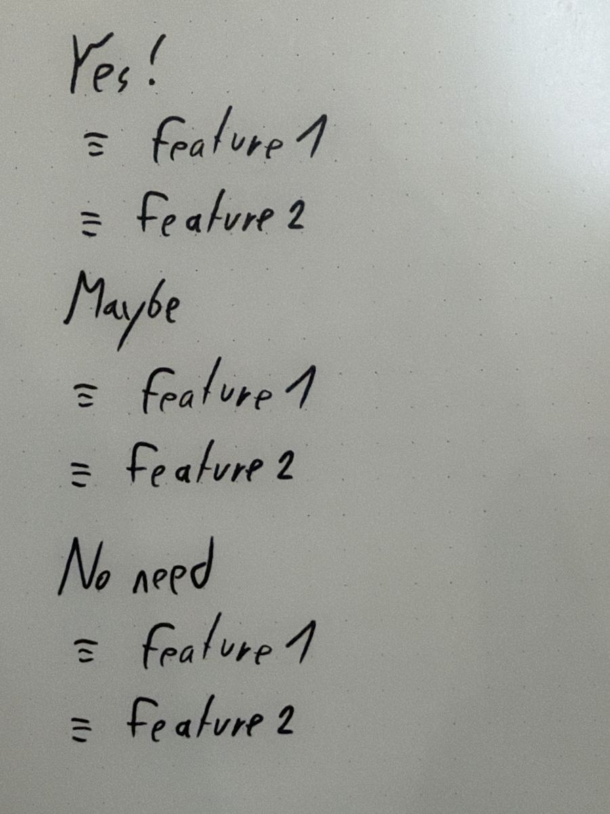
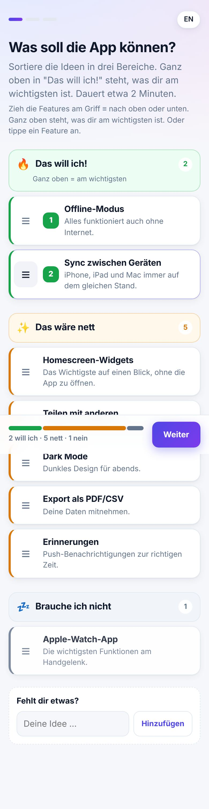
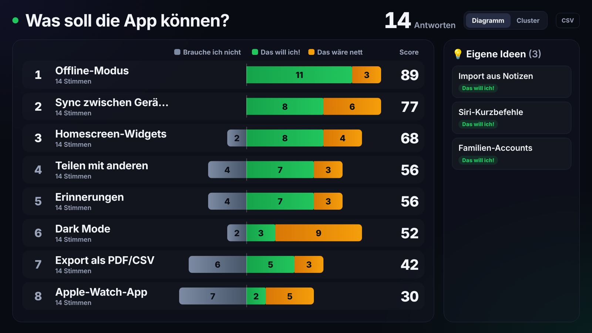
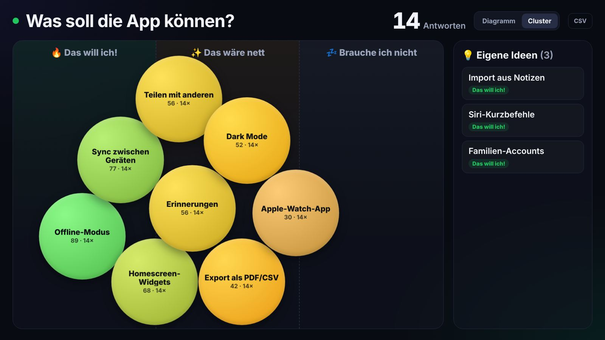

# Entstehung: Janeks Input und die Wendepunkte

Wie die App am 17.11.2026 entstanden ist, mit Janeks Aussagen wörtlich.
Nicht hier: Bedienung, Wertung und Datenschutz (siehe `README.md`), Architektur und Deployment (siehe `CLAUDE.md`), offene Entscheidungen (siehe `docs/open-points.md`).

Bei Widersprüchen gilt Janeks jüngste Aussage.

## Janeks Input, chronologisch

Uhrzeiten Europe/Berlin.

### 11:01, Ausgangsfrage

> umfragetool wo ich nutzern verschiedene features geben kann und die daraus eine prioritätenliste machen, vielleicht mit sektionen wie:
> das will ich!
> das wäre nett!
> das brauche ich nicht
>
> ggf. auch mit freitexteingabe für extra features
> was gibts da was wir auf anhieb nutzen können oder sollen wir kurz selbst was bauen?

Vorgeschlagen wurden fertige Tools als Matrix-Frage
(Formbricks, LimeSurvey, Google Forms, Tally)
und der Hinweis auf das Kano-Modell.

### 11:02, Matrix abgelehnt

> ne nicht als matrix sondern als neu ordnbare liste mit drag and drop und modernem interface und hoher nutzerfreundlichkeit

Fertige Tools fielen damit weg:
Ranking-Fragen kennen nur eine Liste,
Card-Sorting-Tools kein Ranking innerhalb einer Kategorie.
Entscheidung: selbst bauen.

### 11:04, Teilnahme und Live-Auswertung

> anonym optional mit name und email adresse, am ende testflight link für leite zum ausprobieren
> auswertungsansicht live wie bei mentimeter mit so live clustering und verschiebung pro antwort oder sowas?

Daraus: anonyme Teilnahme, Name und E-Mail optional,
TestFlight-Link am Ende,
Live-Ansicht mit sichtbarer Bewegung pro Antwort und einer Art Clustering.

Auf Rückfrage hat Janek **"Self-hosted Mini-App"** gewählt,
weil eine bei claude.ai gehostete Seite nur Antworten eingeladener claude.ai-Nutzer speichern kann.

### 11:59, Feedback zur ersten Version (Kanban mit vier Spalten)

> vielleicht als (balken?)diagramm und die texte müssen größer sein soll ja aufm projektor lesbar sein für die summary
> nicht als kanban board sondern einfach nur vertikal mobile first reordering und die sections als gruppierung

### 12:01, Skizze

> Ungefähr so

Eine einzige vertikale Liste,
drei Überschriften als Gruppierung,
Features mit Griff `≡` **links**.
Kein Stapel "noch zu sortieren", keine Spalten, keine Schnellwahl-Buttons.

### 12:38 bis 12:47, Deployment

> kannst du mir das auf iridion live bringen? kann ich von cowork cloud auf lokal wechseln?

> ich bin aufm rechner, probiers oder gib mir instructions für eine separate session

> können wir das auch ohne docker? der server hat hestiacp und damit nativ php bereit

Aus der Cloud-Sitzung war kein SSH möglich,
deshalb gab es einen Prompt für eine lokale Claude-Code-Sitzung.
Für HestiaCP entstand eine PHP-Portierung (siehe Wendepunkte).

### 12:54, Kritik am Diagramm

> die balken sind etwas meh denn das ist eigentlich eine klare hierarchie die hast du da durchbrochen

Noch nicht umgesetzt, siehe `docs/open-points.md`.

## Wendepunkte

| Stand | Umfrage | Live-Ansicht | Auslöser |
| --- | --- | --- | --- |
| v1 | Kanban, vier Spalten inkl. "Noch zu sortieren", Schnellwahl-Chips | gestapelte 100 %-Balken + Cluster, kleine Schrift | Anforderungen 11:04 |
| v2 | vertikale Liste mit Stapel oben, Griff rechts | wie v1 | Feedback 11:59 |
| v3 | exakt nach Skizze, alles startet in "Das wäre nett" | Beamer-Layout, divergierende Balken, Cluster als zweiter Tab | Skizze 12:01 |

v3 ist der Stand, mit dem das Repo angelegt wurde.

### PHP-Portierung

Für HestiaCP auf Iridion entstand zuerst eine PHP-Variante mit kopiertem Frontend.
Ins Repo kam sie nicht als Kopie,
weil zwei Frontends auseinanderlaufen würden,
sondern auf Janeks Wunsch (13:01, "add the php port as separate PR") als `php/`
mit gemeinsamem `public/` und umschaltbarem Backend-Adapter (PR #2).

## Janeks allgemeine Vorgaben für Texte

- Keine Gedankenstriche (em dashes)
- Im Deutschen neutrale Formen statt ausführlicher Gender-Konstruktionen ("Teilnehmende")
- Markdown statt Word
